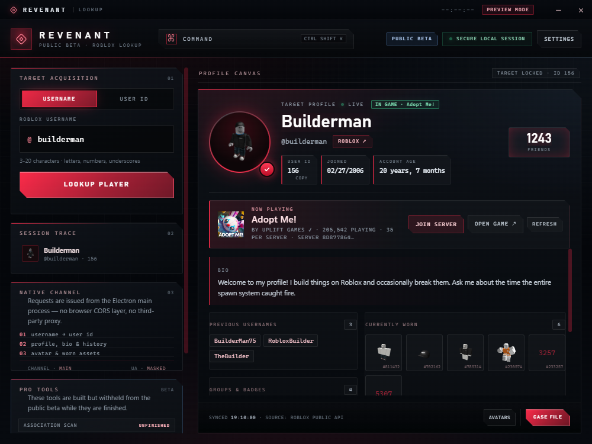
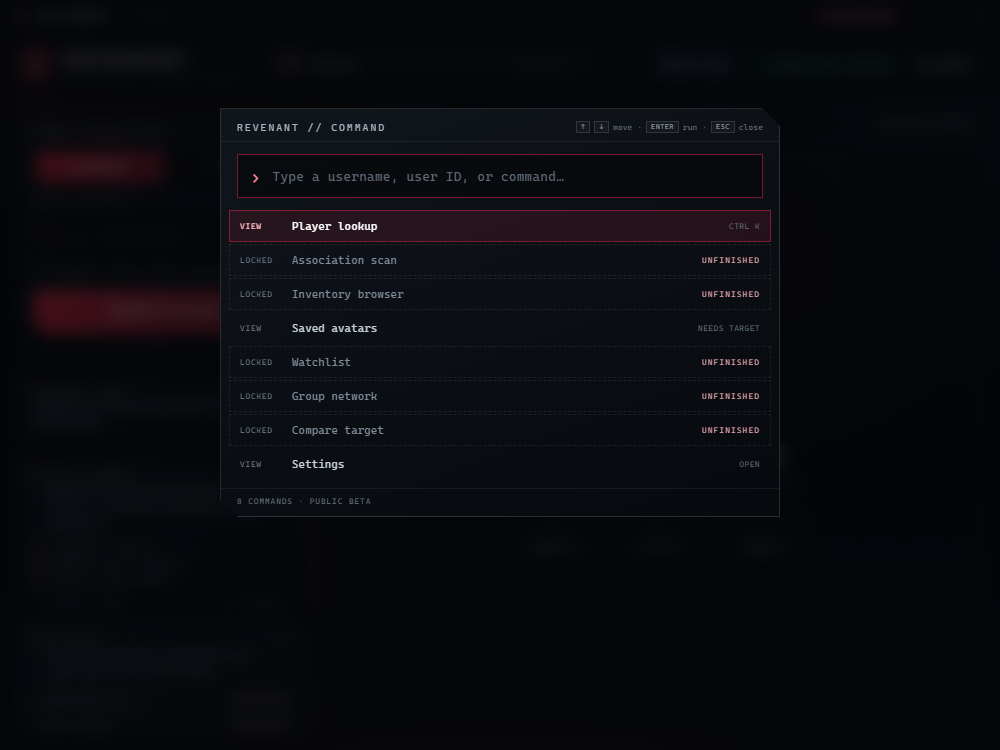
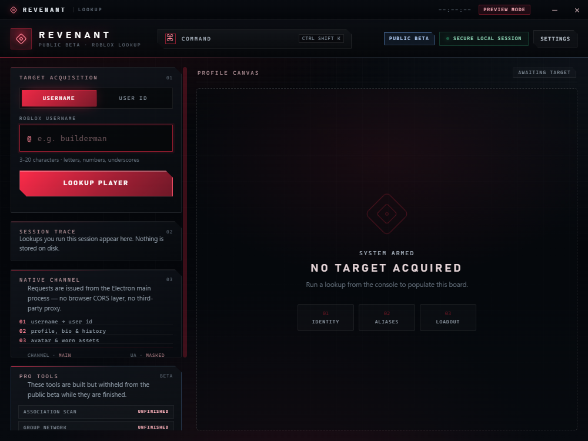

# Revenant Lookup — Public Beta

A fast, private Roblox player lookup utility for Windows. No Roblox login, no cookies, no
telemetry — it reads public endpoints and puts the useful parts on one screen.

**[Download the public beta](https://github.com/Krillekz/revenant-lookup/releases)**

## What you get

- **Lookup by username or user ID** — display name, join date, account age, bio, ban flag,
  previous usernames, friends, groups and badges.
- **Live status** — whether the account is in a game, online or offline, refreshed on a cadence
  you choose.
- **Join the same server** — when the target has joins enabled and is in a joinable experience,
  Revenant produces the exact `roblox://` deep link that launches Roblox into their server.
- **Saved avatars** — browse a player's public outfits and inspect the items in each one.
- **Case file** — export a self-contained HTML report with an embedded, print-ready PDF.
- **Command palette** — `Ctrl+Shift+K` for lookups, navigation, export, copy-ID and more.
- **Local-only state** — recent targets and preferences stay on your machine.

## Unfinished in the public beta

These tools exist in the private build but are deliberately withheld from the beta. You will see
them labelled **UNFINISHED**; selecting one explains that instead of doing anything.

- Association scan (possible alternate accounts)
- Group network graph
- Full inventory browser and loadout valuation
- Target comparison
- Watchlist change tracking
- Per-account case notes

They are not broken, and they are not for sale — they are simply not ready to publish.

## Install

1. Download `Revenant-Lookup-Beta-Setup-2.0.0-beta.1.exe` from the latest release.
2. Run it and choose an install folder.
3. Launch **Revenant Lookup Beta** from the Start menu or desktop.

Requirements: Windows 10 or 11, x64. The installer bundles everything; Node.js and Roblox Studio
are not required.

The beta is unsigned, so Windows SmartScreen will show a warning on first launch. Choose
**More info → Run anyway** if you trust the download. Verify the SHA-256 against `CHECKSUMS.txt`
on the release page.

## Screenshots

| Command palette | Dashboard |
| --- | --- |
|  |  |

## Privacy

- Reads public Roblox profile, presence, avatar and group endpoints anonymously.
- Never asks for a Roblox password, cookie or `.ROBLOSECURITY` token.
- No analytics, telemetry, crash reporting or background uploads.
- Exported case files and preferences are written locally only.

## Known limitations

- Roblox rate limits apply; repeated lookups of the same account can pause briefly.
- The join link only works if the target has **Who can join me** enabled and is currently in a
  joinable experience. Offline targets produce no link.
- The app is a desktop utility, not a live monitor: nothing is checked while it is closed.
- The beta is Windows-only and unsigned.
- Public endpoints change; a broken field usually means Roblox changed a response shape, not that
  the lookup is gone.

## Feedback

Open an issue with the version, what you did, and what happened. Screenshots of the case file or
the lookup card help. Please do not paste personal information about other players.

## License

All rights reserved. The beta binary is provided as-is for personal use. Redistribution,
modification or resale of the application is not permitted.
